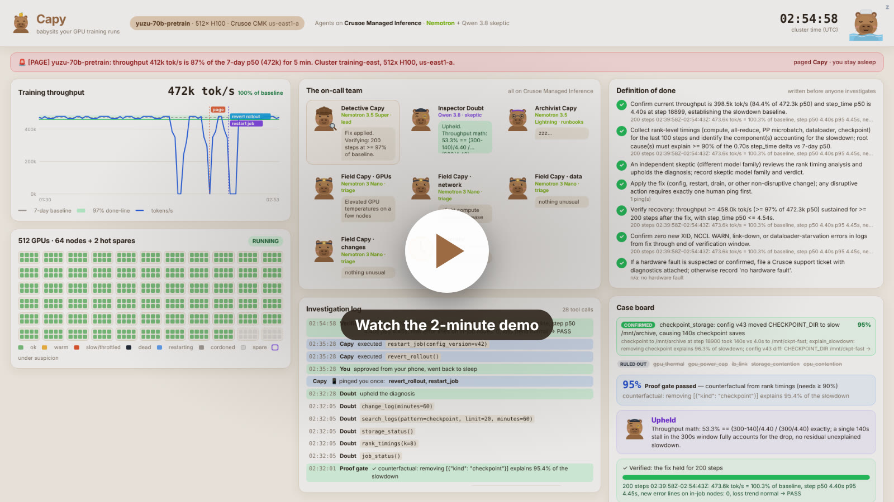
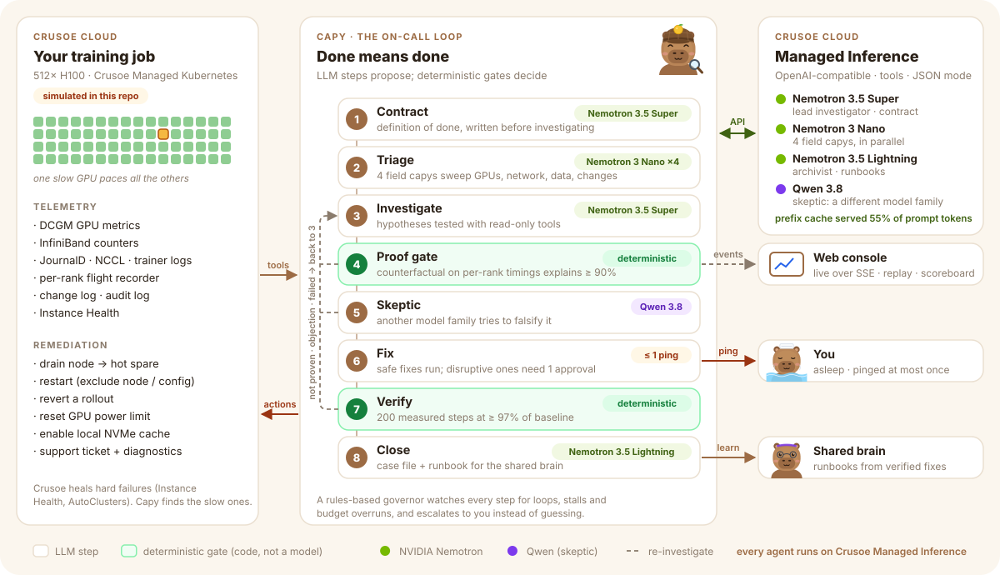

# Capy: an AI on-call team for GPU training runs on Crusoe

**What:** Capy is a team of AI agents (capybaras) that babysits multi-node training jobs on Crusoe, so the humans can sleep.<br>
**Problem:** the costly failures are gray, not hard. One throttling GPU, a flapping InfiniBand link or a bad config change slows all 512 GPUs by 10–30% while every health check stays green. And AI agents asked to fix it tend to say "done" when it isn't.<br>
**Solution:** Capy writes the definition of done before it investigates, proves the root cause with a counterfactual on per-rank timings, has a second model family try to falsify it, asks a human at most once, and closes the incident only after 200 measured steps at ≥ 97% of normal speed.

<p align="center"><a href="https://www.youtube.com/watch?v=RyOno2s7pEo"></a></p>
<p align="center"><b><a href="https://www.youtube.com/watch?v=RyOno2s7pEo">▶ Watch the 2-minute demo</a></b> · <a href="FAQ.md">Judges' FAQ</a> · Crusoe × NVIDIA hackathon, <i>Done Means Done</i> track · every agent runs on Crusoe Managed Inference</p>

> AutoClusters replaces dead GPUs. Capy finds the slow ones, and proves it.

## Architecture

<p align="center"></p>

- **Left, your training job on Crusoe.** Capy reads telemetry through read-only tools and acts through a short list of remediations. In this repo a simulator stands in for the cluster (512× H100 with injected faults and ground truth), so every incident is reproducible and scored.
- **Middle, the loop.** LLM steps propose; code decides. The proof gate and the verifier are deterministic, so no agent can talk its way past them. A failed gate sends the case back to investigation. A rules-based governor stops loops, stalls and budget overruns, and escalates instead of guessing.
- **Right, Crusoe Managed Inference.** Every agent call goes to one OpenAI-compatible endpoint: three Nemotron models plus Qwen 3.8 as the skeptic. You get at most one approval ping, verified fixes become runbooks for the next incident, and the web console streams all of it live.

| Step | Agent | What has to be true to move on |
|---|---|---|
| 1. Contract | Detective Capy | A definition of done exists before anyone investigates: 200 steps at ≥ 97% of baseline, a cause that explains ≥ 90% of the slowdown, a skeptic who agrees, no new errors, at most one ping. Policy floors can be tightened, never loosened. |
| 2. Triage | 4 Field Capys | GPUs, network, data pipeline and recent changes are swept in parallel. Findings are leads, not conclusions. |
| 3. Investigate | Detective Capy | Hypotheses are tested with read-only tools and tracked on a case board. |
| 4. Proof gate | code | Remove the claimed cause from the per-rank flight recorder and recompute the critical path. Below 90% explained means keep looking, which is how a second, hidden fault gets caught. |
| 5. Skeptic | Inspector Doubt | A different model family tries to falsify the diagnosis and the fix (is there a cheaper safe fix? are the arguments right?). |
| 6. Fix | Capy | Safe fixes run immediately. Disruptive ones (drain, restart, kill, pause) send one ping with the proof, the skeptic's verdict and the GPU-hour cost attached. |
| 7. Verify | code | 200 real steps are measured after the fix takes effect. A failure means re-plan, never a victory lap. |
| 8. Close | Archivist Capy | The case file and a runbook go into the team's shared brain. Only verified fixes become lessons. |

## How we leverage Crusoe

### Crusoe Managed Inference runs every agent

| Agent | Model on Crusoe | Why this model |
|---|---|---|
| Detective Capy: lead, contract | `nvidia/NVIDIA-Nemotron-3.5-Super-VL` | The strongest reasoning and tool calling, for an investigation that takes 10–30 tool calls. |
| 4 Field Capys: triage | `nvidia/NVIDIA-Nemotron-3-Nano-30B-A3B` | A small MoE (3B active), so four sweeps run in parallel for a fraction of a cent. |
| Archivist Capy: case file, runbook | `nvidia/Nemotron-3.5-Lightning-30B-A3B` | A fast writer for summaries. Falls back to Nano when capacity is busy. |
| Inspector Doubt: skeptic | `Qwen/Qwen3.8-27B` | The only non-Nemotron model, on purpose: a different family has different blind spots. |

- **Tool calling and JSON mode** on every agent, and the `enable_thinking` switch set per call: reasoning on for investigation and triage, off where we need fast structured output (the contract, the skeptic's verdict, the case file).
- **Prefix caching:** stable system prompts and the shared brain sit at the front of every prompt. On the test sweep, 55% of Capy's prompt tokens were served from Crusoe's cache.
- **Throughput:** four triage calls in parallel per incident and a 12-way concurrent benchmark, inside the account's 500k tokens/min limit. The client retries 429s and 503s with backoff, falls back per role, and accounts tokens, cache hits and cost per run.
- **Cost:** 5.2¢ of inference per incident on average, against roughly 100 GPU-hours at stake.

### Capy extends the platform it runs on

Crusoe already heals hard failures: Instance Health flags XID errors, AutoClusters replaces dead nodes, Active Health Checks test idle ones. Capy is the job-level layer for failures that are slow but alive. It also brings the evidence a team needs before switching automation on; AutoClusters ships with remediation off by default. Every Capy tool maps onto a Crusoe surface:

| Capy tool | Production source on Crusoe |
|---|---|
| `gpu_outliers`, `gpu_detail`, `node_detail` | Command Center metrics (DCGM fields) through the Prometheus-compatible API |
| `search_logs` | Command Center logs (JournalD, including XID lines) through LogsQL |
| `fleet_health` | Command Center Instance Health |
| `collect_diagnostics`, `file_support_ticket` | `crusoe diagnostics vm create` bug reports and Crusoe support |
| `drain_node` | AutoClusters / Crusoe Managed Kubernetes node replacement with hot spares |
| `change_log` | Crusoe audit logs, plus your CI/CD and ArgoCD history |
| `rank_timings`, `explain_slowdown` | the PyTorch / NCCL flight recorder exported by the trainer |

- **Telemetry can stay in the customer's project:** Nemotron is open, so the whole team can run on a self-serve Nemotron deployment inside the customer's own Crusoe project.
- **Next:** point the read-only tools at Command Center on a real job, and turn verified incidents into a fine-tuning set for Nemotron 3.5 Lightning with Crusoe's serverless fine-tuning, so routine triage moves to the small model.

## Results

Both agents run live on Crusoe Managed Inference against simulated incidents, scored by the simulator's ground truth 75 minutes after the page. The baseline is a single Nemotron 3.5 Super agent with **the same tools** and the same approval rule, so the comparison isolates Capy's loop.

**Test split** (new seeds, 3 fault types that no prompt or dev scenario mentions, two-fault incidents): 34 incidents scored for both agents. Full tables are in [results/test/summary.md](results/test/summary.md).

| | Capy | single agent |
|---|---|---|
| job actually fixed | 97.1% | 97.1% |
| false "done" claims | **0** | 1 |
| wasted disruptive actions | **0** | 1 |
| correct root cause | 94.1% | 97.1% |
| escalated to a human | 1 | 0 |
| GPU-hours lost / incident | 101.6 | 100.7 |
| human pings / incident | 0.76 | 0.74 |
| inference cost / incident | 5.2¢ | 0.7¢ |

- **Same fix rate; the difference is whether "done" means done.** The single agent once measured 50 steps that fell between two slow checkpoint saves, saw 101.5%, and declared the job "self-recovered". It stayed at 78%, losing about 114 GPU-hours every hour after the incident was closed. That run opens the video. The single agent also drained a healthy node over a stale XID 13 log line. Capy did neither.
- **Capy's misses were loud, not silent.** It escalated one held-out checkpoint stall to a human after ruling out the right cause too early, and it labeled one PCIe downtraining as a slow NIC on the right node (the fix still worked).
- **The two-fault incident:** Capy lost 50 GPU-hours, the single agent 142.
- **Honest caveats:** the sample is small, and 1 vs 0 is an anecdote, not a significant difference. The structural point holds on its own: the 50-step check that fooled the single agent cannot pass Capy's contract. Six more test incidents aren't scored because a run didn't finish: three Capy runs hit harness bugs (since fixed), and three were cut off near the end of the sweep when our Crusoe account started returning HTTP 402 (billing). The dev split (18 incidents) was used while building, so it isn't a fair test: [results/dev/summary.md](results/dev/summary.md).

## Why it's a product

- **Buyer:** any team running multi-node training or fine-tuning on rented GPUs, and Crusoe itself, as a managed feature next to AutoClusters and Command Center.
- **ROI:** a 512-GPU job running 25% slow loses about 128 GPU-hours every hour. Capy costs cents of inference per incident, and its median incident is verified fixed 29 minutes after the page, not the next morning.
- **Trust is the product:** every fix comes with a proof and a skeptic's verdict, and is measured before anyone calls it done, so a team can let Capy act while they sleep.

## Run it

```bash
python -m venv .venv && . .venv/bin/activate && pip install -r requirements.txt
uvicorn capy.server:app --port 8765    # open http://localhost:8765 and press ▶ Replay (no API key needed)
```

Live runs and the benchmark need a Crusoe Managed Inference key:

```bash
cp .env.example .env                   # add CRUSOE_API_KEY
python scripts/smoke_test.py           # checks tool calling, JSON mode, the thinking switch and rate limits
python scripts/run_incident.py demo-sticky --agent capy                          # one incident in the terminal
python -m capy.bench --split test --agents capy,baseline --out results/test --traces
python -m capy.bench --split test --out results/test --summarize                # rebuild the paired scoreboard
```

In the console, "Run live on Crusoe" starts a real run and you approve the ping yourself. The scoreboard is at `/results`.

## Repo map

```
capy/sim.py        512× H100 cluster + training job simulator: DCGM metrics, IB counters, JournalD/NCCL/trainer logs,
                   change log, Instance Health, per-rank flight recorder; fault injection, remediation, ground truth
capy/scenarios.py  dev set, test set (new seeds, 3 held-out fault types, two-fault incidents), demo incidents
capy/tools.py      the agents' read-only tools and actions, each with a simulated time cost
capy/agents.py     the Capy team, the governor, the proof gate, and the single-agent baseline
capy/llm.py        Crusoe Managed Inference client: retries, fallbacks, token, cache and cost accounting
capy/bench.py      benchmark runner and paired scoreboard
capy/server.py     FastAPI: live runs over SSE, approvals, trace replay, results
web/               the console (vanilla JS, hand-drawn SVG capybaras) and the scoreboard page
traces/            recorded incidents the console replays
video/             demo video pipeline (ElevenLabs narration, Playwright recording, ffmpeg)
```

## Limits

- **It's a simulator, not a cluster.** Failure signatures follow real behavior (NVML throttle reasons, XID 79 and PCIe downtraining lines, mlx5 link flaps, `NCCL_IB_HCA` effects, synchronous critical-path timing), and every remediation costs what it would cost. Agents never see the hidden fault list. But nothing here has touched production telemetry yet.
- **The benchmark is small:** 52 incidents across dev and test. Read the differences as direction, not proof.
- **The baseline is strong on purpose.** It gets Capy's tools, so the comparison measures the loop, not the tooling.
