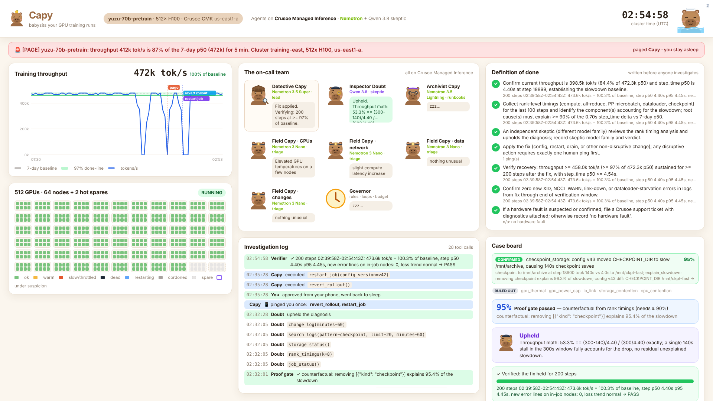

# Capy: babysits your GPU training runs

**Capy is an on-call team of AI capybaras that watches multi-node training runs on Crusoe, finds gray failures (the GPU that got slow, not the one that died), proves the root cause, fixes it, and only says "done" after the job has demonstrably recovered. It asks for at most one approval, and only when the fix is disruptive.**

Built for the Crusoe × NVIDIA hackathon, *Done Means Done* track. All agents run on **Crusoe Managed Inference**. The team is Nemotron end to end (3.5 Super, 3 Nano, 3.5 Lightning), plus one deliberately different model family (Qwen 3.8) as the skeptic.

<p align="center"></p>

**Demo video (about 2 minutes):** [video/capy-demo.mp4](video/capy-demo.mp4), a replay of a real benchmark run with narration.

## The problem

A synchronous training job runs at the speed of its slowest rank. Meta's Llama 3 run saw **419 unexpected interruptions in 54 days on 16k GPUs** (about one every 3 hours, ~78% hardware). The expensive ones are often *gray*: one GPU thermally throttling, a flapping InfiniBand link, a launcher config that pinned NCCL to one NIC, a canary daemonset that power-capped a node. Nothing throws an XID, so the health checks stay green. 512 GPUs quietly run 10 to 30% slower until a human notices in the morning.

Crusoe already handles **hard** failures: Instance Health flags XID codes, AutoClusters replaces dead nodes, Active Health Checks test idle nodes. Capy is the complement. It reasons at the **job** level, about **slow-but-alive** failures, and it brings the evidence that lets you trust automation. AutoClusters ships with every remediation off by default; proof is what turns it on.

> AutoClusters replaces dead GPUs. Capy finds the slow ones, and proves it.

## Done means done

Most agents fill a vague goal with assumptions and then confidently report success. Capy's loop exists to stop that.

| Step | Who | What "done" requires |
|---|---|---|
| 1. Contract | Detective Capy (Nemotron 3.5 Super) | Writes the **definition of done** before investigating: throughput ≥ 97% of baseline for 200 steps; root cause explains ≥ 90% of the slowdown; an independent skeptic upholds it; no new errors; at most one human ping; hardware faults get a support ticket. Policy floors can be tightened, never loosened. |
| 2. Triage | 4 Field Capys (Nemotron 3 Nano, in parallel) | Sweep GPUs, network, data pipeline and recent changes. Findings are leads, not conclusions. |
| 3. Investigate | Detective Capy | Tests hypotheses with read-only tools and keeps the case board current. |
| 4. Governor | rules | Catches **loops** (repeated identical calls), **stalls** (no new evidence) and **budget** overruns. Decides re-plan, wrap-up or escalate. |
| 5. Proof gate | deterministic | A **counterfactual** on the per-rank flight recorder: remove the claimed cause, re-run the critical path. Below 90% means "keep looking", which is how two-fault incidents get caught. |
| 6. Skeptic | Inspector Doubt (**Qwen 3.8**) | A different model family tries to **falsify** the diagnosis and the fix (is there a cheaper safe fix? right args?). It must object with evidence. |
| 7. Fix | Capy | Non-disruptive fixes run immediately. Disruptive ones (drain, restart, pause, kill) send **one ping** with the proof, the skeptic's verdict and the GPU-hour cost attached. |
| 8. Verify | deterministic | Measures **200 real steps** after the fix has taken effect. A failure triggers a re-plan, never a victory lap. |
| 9. Close | Archivist Capy (Nemotron 3.5 Lightning) | Writes the case file and a runbook entry for the team's **shared brain**. Only verified fixes become lessons. |

## Results

The benchmark runs simulated incidents on the 512-GPU cluster and scores them against the simulator's ground truth 75 minutes after the page. Both agents run live on Crusoe Managed Inference. The baseline is a single Nemotron 3.5 Super agent with **the same tools** as Capy (including the flight recorder, the counterfactual tool and `verify_recovery`) and the same approval rule for disruptive actions. Capy adds the loop above.

**Test split, unseen:** new seeds, 3 fault types that no prompt or dev scenario mentions, and two-fault incidents. 34 incidents are scored for both agents ([full table](results/test/summary.md)).

| | Capy | single agent |
|---|---|---|
| job actually fixed | 97.1% | 97.1% |
| false "done" claims | **0** | 1 |
| wasted disruptive actions | **0** | 1 |
| correct root cause | 94.1% | 97.1% |
| escalated to a human | 1 | 0 |
| GPU-hours lost / incident | 101.6 | 100.7 |
| human pings / incident | 0.76 | 0.74 |
| median minutes, page to done | 28.9 | 27.2 |
| inference cost / incident | $0.052 | $0.007 |

What this says:

- **Both fix the same share.** With good tools, a single Nemotron 3.5 Super agent is already a capable on-call engineer. The tools do a lot of the work (per-rank flight recorder, counterfactual `explain_slowdown`, measured `verify_recovery`), and they are part of Capy.
- **The difference is whether "done" means done.** The single agent once declared done on a job that was still 22% slow. In `checkpoint_stall-303` it measured 50 steps that fell between two slow checkpoint saves, saw 101.5%, and called the job self-recovered. The job stayed at 78% after it closed the incident, about 114 GPU-hours lost per hour. In `checkpoint_stall-302` it drained a healthy node over a stale XID 13 log line (313 GPU-hours lost vs Capy's 180). Capy did neither.
- **Capy's misses were loud, not silent.** It escalated one held-out checkpoint stall to a human: it tested the checkpoint hypothesis while the first slow save was still in flight, ruled it out too early, and ran out of investigation budget. It also labeled one PCIe downtraining as a slow NIC on the right node; the fix still worked.
- **The sample is small.** 1 vs 0 false "done" claims is an anecdote, not a significant difference. The structural point stands on its own: Capy's contract requires 200 measured steps and a ≥90% counterfactual, so the 50-step check that fooled the single agent cannot pass it.
- **Cost:** Capy uses about 8× the inference of the single agent (5.2¢ vs 0.7¢ per incident). Both are noise next to the ~100 GPU-hours an incident costs. 55% of Capy's prompt tokens were served from Crusoe's prefix cache.
- **Two-fault incidents:** only one is scored (see below). Capy resolved it with 50 GPU-hours lost vs 142 for the single agent.

**Not scored: 6 incidents.** The comparison is paired, so an incident counts only if both agents finished it. Three Capy runs crashed on harness bugs: the lead called `kill_process` without a pid, and a model returned a list where the harness expected one number. Both are fixed. Three more were cut off near the end of the sweep when Crusoe inference started returning HTTP 402 ("Organization has no valid payment method"). They're listed in [results/test/summary.md](results/test/summary.md). Re-run them once inference credits are back:

```bash
python -m capy.bench --split test --agents capy --out results/test --traces \
  --only cpu_contention-302,pcie_downgrade-303,pcie_downgrade-304,thermal+nccl_regression-402,ib_flap+power_cap-403,cpu_contention+thermal-404
python -m capy.bench --split test --out results/test --summarize
```

**Dev split:** 18 incidents, used while building, so not a fair test ([table](results/dev/summary.md)). Neither agent made a false "done" claim. Capy fixed 94.4% vs 100%: it escalated a power cap that a daemonset kept re-applying, which is why `revert_rollout` exists now.

## Why it's a product, and why Crusoe

- **Buyer:** anyone running multi-node training or fine-tuning on rented GPUs, and Crusoe itself as a managed feature next to AutoClusters and Command Center.
- **ROI:** a 512-GPU job losing 25% is about 128 GPU-hours per hour. Capy costs cents of inference per incident.
- **Integration path:** every tool maps onto a real Crusoe surface:

| Capy tool | Production source on Crusoe |
|---|---|
| `gpu_outliers`, `gpu_detail`, `node_detail` | Command Center metrics (DCGM fields) via the Prometheus-compatible API |
| `search_logs` | Command Center logs (JournalD incl. XID lines) via LogsQL |
| `fleet_health` | Command Center Instance Health |
| `collect_diagnostics`, `file_support_ticket` | `crusoe diagnostics vm create` bug reports + Crusoe support |
| `drain_node` | AutoClusters / CMK node replacement with hot spares |
| `change_log` | Crusoe audit logs + your CI/CD and ArgoCD history |
| `rank_timings`, `explain_slowdown` | PyTorch / NCCL flight recorder exported by the trainer |

- **Privacy:** Nemotron is open, so Capy can run on a self-serve Nemotron deployment inside the customer's own Crusoe project, and telemetry never leaves it.
- **Cache-friendly:** stable system prompts and the shared brain sit at the front of every prompt, so successive calls hit MemoryAlloy's prefix cache: 55% of Capy's prompt tokens on the test sweep were cached. Cached tokens are reported per run (`cached_tokens` in the results).
- **Next:** distill verified incidents into a LoRA on Nemotron 3.5 Lightning with Crusoe Serverless Fine-Tuning, so routine triage gets cheaper every week.

## How it works

```
capy/sim.py        512x H100 cluster + training job simulator: DCGM metrics, IB counters, JournalD/NCCL/trainer
                   logs, change log, Instance Health, flight recorder; fault injection, remediation, ground truth
capy/scenarios.py  dev set, test set (new seeds + 3 held-out fault types + two-fault incidents), demo incidents
capy/tools.py      the agents' tools (read-only + actions) with simulated time costs
capy/agents.py     the Capy team and the single-agent baseline (same model, same tools)
capy/llm.py        Crusoe Managed Inference client: retries on 429/503, fallbacks, token + cost + cache accounting
capy/bench.py      benchmark runner and scoreboard
capy/server.py     FastAPI: live runs over SSE, approvals, trace replay, results
web/               the capybara console (vanilla JS + hand-drawn SVG capybaras) and the scoreboard page
video/             demo video pipeline (ElevenLabs narration + Playwright recording + ffmpeg)
```

**The simulator is honest about what it is.** It's a simulator, not a cluster. Failure signatures follow real behavior: NVML throttle-reason bits, `nvidia-smi` power-limit messages, kernel XID 79 / AER / PCIe downtraining lines, mlx5 link flaps, `NCCL_IB_HCA` effects, synchronous critical-path timing. The agents never see the hidden fault list. "Fixed" is judged by the simulator's ground truth 75 minutes after the page, not by the agent. Every remediation costs what it would cost: drains swap a hot spare and roll back to the last checkpoint, approvals take three minutes, and each tool call and model call costs simulated time while 512 GPUs run slow.

## Run it

```bash
python -m venv .venv && . .venv/bin/activate && pip install -r requirements.txt
cp .env.example .env            # add CRUSOE_API_KEY (Intelligence API key)
python scripts/smoke_test.py    # day-0 check: tool calling, JSON, thinking toggle, images, rate limits
uvicorn capy.server:app --port 8765
# open http://localhost:8765  -> replay a recorded incident, or "Run live on Crusoe" and approve the ping yourself
python scripts/run_incident.py demo-sticky --agent capy          # one incident in the terminal
python -m capy.bench --split test --agents capy,baseline --out results/test --traces
python -m capy.bench --split test --out results/test --summarize   # rebuild the paired scoreboard from runs.jsonl
ELEVENLABS_API_KEY=... NODE_PATH=$(npm root -g) node video/make_video.mjs   # re-render the demo video (server must be running)
```

Models used (all via `https://api.inference.crusoecloud.com/v1`): `nvidia/NVIDIA-Nemotron-3.5-Super-VL` (lead, contract, baseline), `nvidia/NVIDIA-Nemotron-3-Nano-30B-A3B` (field triage), `nvidia/Nemotron-3.5-Lightning-30B-A3B` (archivist), `Qwen/Qwen3.8-27B` (skeptic).

## Limits

- It's a simulator, not a cluster. The failure signatures follow real behavior, but nothing here has touched production telemetry yet. The next step is pointing the read-only tools at Command Center's Prometheus and LogsQL APIs on a real job.
- The benchmark is small: 52 incidents across dev and test. Treat the differences as direction, not proof.
- The single agent gets Capy's tools, which makes it strong. That's deliberate: the comparison isolates the loop (contract, governor, proof gate, skeptic, verification), not the tooling.
- Live runs need Crusoe inference credits. Replays of recorded runs (the console's default, and the video) need no inference.
